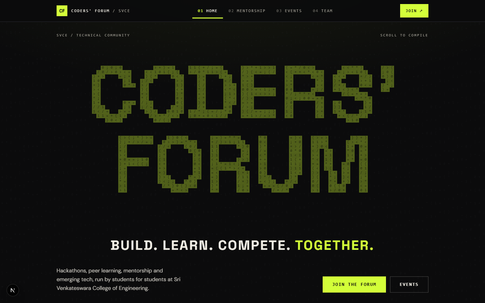
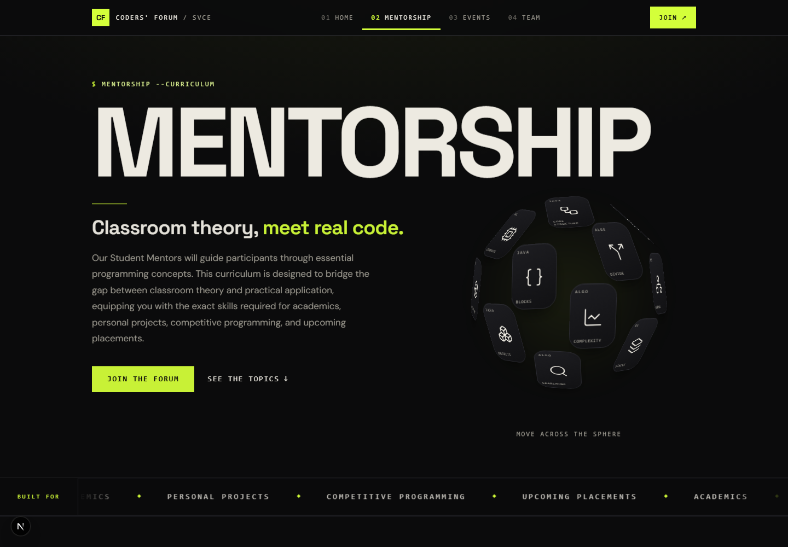

# Coders' Forum

The website for the Coders' Forum, a student-run technical community at Sri Venkateswara College of Engineering (SVCE): hackathons, peer learning, mentorship and emerging tech.

## Why this exists

Honestly? Because I just like to. (Or not. I'm kidding.)

It started as a redesign and kept growing, one "can we make it pop a bit more" at a time.

## What's in it

- **Home:** a glyph-field hero where the wordmark resolves out of code characters, a scroll-driven typewriter section ("The forum compiles"), a build log, a mentorship teaser and a join call to action.
- **Mentorship:** a split hero with a hover-reactive 3D sphere of topic cards, a rotating "Built for" ribbon, four expanding topic panels (Data Structures, Algorithms, Java, Machine Learning) and a "Why join" section.
- **Events and Team:** placeholder pages for now.

Dark theme only: near-black, cream and acid lime. Tokens live in `app/globals.css` as `--cf-*` variables.

## Screenshots

**Home**



**Mentorship**



## Stack

- [Next.js](https://nextjs.org) 16 (App Router) and React 19
- Tailwind CSS 4
- Framer Motion for scroll and reveal animation, Lenis for smooth scrolling
- Lucide icons and a few shadcn-style components (Base UI)

This version of Next.js has breaking changes from older releases. If you are about to write framework code, read the guides in `node_modules/next/dist/docs/` first.

## Running it

```bash
npm install
npm run dev
```

Open [http://localhost:3000](http://localhost:3000). If that port is taken, Next.js tells you which one it picked.

Other scripts:

```bash
npm run build   # production build
npm run lint    # ESLint
```

## Layout

```
app/                    routes: / , /mentorship, /events, /team
components/home/        glyph-field, hero, typewriter story, home sections
components/mentorship/  topic sphere, expanding panels, why-join, topic data
components/             navbar, footer, ribbon, reveal, custom cursor, magnetic link
lib/                    nav links and small helpers
```

## Notes

- Motion respects `prefers-reduced-motion`: the sphere, ribbon and glyph field stay still, and transitions become instant.
- Copy is based on what the club actually does. There are no invented member counts, dates or results. The join link, events, mentors and team are still to be filled in.
